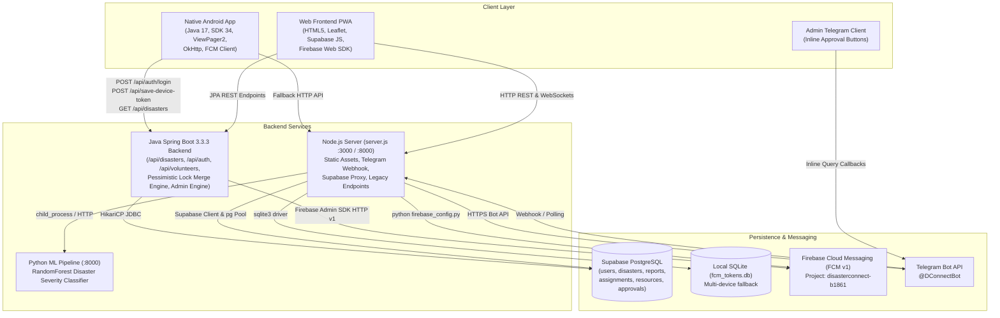
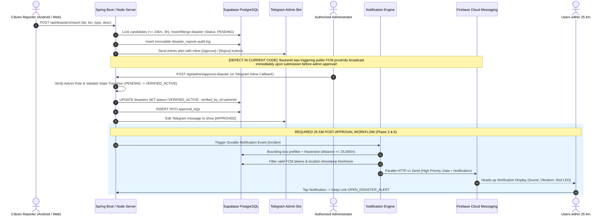

# D-Connect Disaster Management Coordination System
## Complete End-to-End Architecture & Repository Audit

**Author / Role:** Senior Software Architect, Android Engineer, Java Spring Boot Engineer, FCM Specialist, Supabase Engineer, Performance & Security Auditor  
**Date:** October 2026  
**Repository Branch:** `main`  
**Target Platform:** Web (PWA / Responsive Desktop & Mobile), Native Android (Java SDK 34), Java Spring Boot 3.3.3 Backend, Node.js HTTP/API Gateway Server, Supabase PostgreSQL DB, Firebase Cloud Messaging (FCM v1), Telegram Bot Integration, Scikit-Learn ML Pipeline  

---

## 1. Executive Summary & Discovered Architecture

The D-Connect workspace is a multi-tier disaster response coordination platform consisting of:
1. **A Native Android Application** (`android/app`) built in Java 17 targeting Android SDK 34 (minSdk 24). Uses Android Jetpack, `ViewPager2`, `TabLayout`, Material 3 design, OkHttp 4.12, Gson 2.10, Google Play Services Location 21.2, and Firebase Cloud Messaging (BOM 33.9.0).
2. **A Web Frontend (PWA)** (`public/`, `src/main/resources/static/`, and root `index.html`) using Vanilla JavaScript (ES6+), Leaflet Maps 1.9.4, Supabase JS v2, and Firebase Web SDK v9.
3. **A Dual-Backend Architecture**:
   - **Java Spring Boot 3.3.3 Backend** (`src/main/java`): Full REST API suite running on Spring Web, Spring Data JPA with HikariCP, PostgreSQL driver, and Firebase Admin SDK 9.3.0. Provides transaction-safe disaster deduplication (pessimistic locking `SELECT FOR UPDATE` within 10km / 3 hours), volunteer assignment, and admin verification.
   - **Node.js Gateway / Server** (`server.js`): Single-process HTTP server connecting to Supabase PostgreSQL (`@supabase/supabase-js` and `pg`), serving static web assets, Telegram bot long-polling/webhook bridge (`telegramBot.js`), and invoking local Python scripts for ML and FCM fallback.
4. **Supabase PostgreSQL Database**: Hosted on Supabase (`db.qpxnsxphwufrnfejphat.supabase.co:5432`), storing users, sessions, disasters, audit reports, volunteer profiles, assignments, emergency resource items, and approval logs.
5. **Firebase Cloud Messaging**: Project ID `disasterconnect-b1861`, package `com.dconnect.app`, initialized with service account `firebase_service_account.json` / `firebase-service-account.json`.
6. **Telegram Bot Dispatcher**: Bot Token `8778978825:AAFoTE5ixdli9HGYVpyArQOIZ-vc7Pkpps4` with interactive inline callbacks (`approve_<id>`, `reject_<id>`).
7. **Disaster Severity ML Predictor**: Random Forest / TF-IDF scikit-learn model (`ml_pipeline.py`, `model.pkl`, `vectorizer.pkl`) exposed via `api_service.py` on port 8000 and mirrored in `IncidentPredictionService.java`.



---

## 2. Component Inventory & Source File Map

| Component | Technology | Primary Source Files | Configuration / Metadata |
|---|---|---|---|
| **Android App** | Java 17, Android SDK 34 | `android/app/src/main/java/com/dconnect/app/` (`DConnectApplication.java`, `LoginActivity.java`, `DashboardActivity.java`, `ApiClient.java`, `DConnectMessagingService.java`, fragments) | `android/app/build.gradle`, `AndroidManifest.xml`, `google-services.json` |
| **Spring Boot Backend** | Java 17/21, Spring Boot 3.3.3 | `src/main/java/com/disaster/coord/` (`DisasterService.java`, `AdminService.java`, `DisasterNotificationService.java`, `FirebasePushSender.java`, controllers, entities) | `pom.xml`, `application.yml`, `firebase-service-account.json` |
| **Node.js Server** | Node.js 18+, CommonJS | `server.js`, `supabaseClient.js`, `telegramBot.js`, `health_monitor.js` | `package.json`, `.env`, `ecosystem.config.js` |
| **Database** | PostgreSQL 15 (Supabase) | `src/main/resources/db/supabase_complete_schema.sql`, `src/main/resources/schema.sql` | Supabase connection string in `.env` and `application.yml` |
| **FCM Dispatch** | Google Firebase Admin SDK | Java: `FirebasePushSender.java`<br>Python: `firebase_config.py`<br>Node: `server.js` | `firebase_service_account.json` (Service Account Key) |
| **ML Inference** | Scikit-Learn, FastAPI/Flask | `ml_pipeline.py`, `api_service.py`, `python_ml_standalone.py`, `DisasterMLPipeline.java` | `model.pkl`, `vectorizer.pkl` |
| **Web Frontend** | HTML5, Vanilla JS, CSS3 | `public/index.html`, `public/js/app.js`, `public/css/style.css` (mirrored in `src/main/resources/static/`) | `manifest.json`, `sw.js` |

---

## 3. Incident Lifecycle & Event Flow Analysis

### Current vs. Required State



---

## 4. Database Schema & Security Policy Audit

### Table Relationships & Key Columns
1. **`users`**:
   - `id` (BIGINT PK), `name`, `phone` (UNIQUE), `password_hash`, `role` (`USER`, `VOLUNTEER`, `NGO`, `GOVERNMENT_AGENCY`, `ADMIN`), `status` (`PENDING_APPROVAL`, `ACTIVE`, `REJECTED`, `SUSPENDED`), `home_lat`, `home_lng`, `fcm_token`, `created_at`, `updated_at`.
   - Indexes: `idx_users_phone`, `idx_users_status_role`, `idx_users_home_coords`.
2. **`user_device_tokens`**:
   - `id` (BIGINT PK), `user_id` (FK `users.id`), `token` (TEXT UNIQUE), `device_type` (`android`, `web`), `updated_at`.
3. **`disasters`**:
   - `id` (BIGINT PK), `type`, `title`, `description`, `severity` (`LOW`, `MEDIUM`, `HIGH`, `CRITICAL`), `latitude`, `longitude`, `location_name`, `status` (`PENDING`, `VERIFIED_ACTIVE`, `IN_PROGRESS`, `RESOLVED`, `CLOSED`), `report_count`, `created_by_id`, `verified_by_id`.
   - Indexes: `idx_disasters_coords` (`latitude`, `longitude`), `idx_disasters_status_type`.
4. **`disaster_reports`**:
   - Immutable audit trail: `id`, `disaster_id` (FK), `reporter_id`, `reporter_phone`, `latitude`, `longitude`, `message`, `reported_at`.
5. **`notifications`**:
   - Push delivery history: `id`, `user_id` (FK), `disaster_id` (FK), `title`, `message`, `is_read`, `created_at`.
6. **`approval_logs`**:
   - Audit trail of administrator actions: `id`, `admin_id` (FK), `target_type` (`DISASTER`, `USER`), `target_id`, `action` (`APPROVED`, `REJECTED`), `comments`, `created_at`.

---

## 5. Confirmed Defects with Source Code Evidence

### Defect 1: Android Client Endpoint Mismatch Causing 404 & Silent Token Drop
- **Location:** `android/app/src/main/java/com/dconnect/app/network/ApiClient.java` line 71.
- **Evidence:** 
  ```java
  Request request = new Request.Builder()
          .url(BASE_URL + "/api/save-device-token")
          .post(body)...
  ```
  Neither Spring Boot (`TokenController.java` only exposes `@PostMapping("/save-token")`) nor Node.js (`server.js` only checked `/api/save-token`, `/save-token`, `/api/users/device-token`, `/register-device-token`) routed `/api/save-device-token`.
- **Result:** Every native Android login or token generation resulted in HTTP 404, 3 failed retries, and the device token was never recorded in Supabase.

### Defect 2: Single-Thread Network Executor Freezing Entire Android UI
- **Location:** `android/app/src/main/java/com/dconnect/app/network/ApiClient.java` lines 40, 52-98.
- **Evidence:**
  ```java
  private static final ExecutorService EXECUTOR = Executors.newSingleThreadExecutor();
  ...
  while (attempt < maxRetries && !success) {
      ...
      Thread.sleep(2000L * attempt); // Blocks the single-thread executor for up to 6+ seconds
  }
  ```
- **Result:** Because `sendDeviceTokenToBackend` failed with 404, it blocked `EXECUTOR` with sequential `Thread.sleep(2000)` and `Thread.sleep(4000)`. All subsequent requests (`getDisasters()`, `getVolunteers()`) were stuck in the single queue, causing massive perceived login and dashboard loading lag.

### Defect 3: Spring Boot Proximity Alerts Bypassed Real FCM (Dead Legacy API & Simulation Fallback)
- **Location:** `DisasterNotificationService.java` line 49 and `FcmNotificationService.java` lines 30-37, 58-65.
- **Evidence:**
  `DisasterNotificationService` called `FcmNotificationService.sendBatchParallel(...)` instead of `FirebasePushSender.java`.
  `FcmNotificationService` had:
  ```java
  @Value("${firebase.fcm.enabled:false}")
  private boolean fcmEnabled;
  @Value("${firebase.fcm.endpoint:https://fcm.googleapis.com/fcm/send}")
  private String fcmEndpoint;
  ```
  `fcmEnabled` defaulted to `false`, logging `[FCM SIMULATION]` without contacting Firebase. Furthermore, `https://fcm.googleapis.com/fcm/send` is the legacy HTTP v1 endpoint terminated by Google in June 2024. Meanwhile, the working OAuth2 Firebase Admin SDK (`FirebasePushSender.java`) was completely bypassed.

### Defect 4: Premature Public Proximity Broadcast on Unapproved Incidents
- **Location:** `src/main/java/com/disaster/coord/service/DisasterService.java` lines 206-215.
- **Evidence:**
  ```java
  // Publish domain event for real-time proximity FCM notifications (< 30km radius)
  eventPublisher.publishEvent(new DisasterCreatedEvent(
          this, targetDisaster.getId(), targetDisaster.getLatitude(), targetDisaster.getLongitude(), ...
  ));
  ```
  This fired immediately inside `createOrMergeDisaster` even when `initialStatus == PENDING`. Conversely, `AdminService.java` lines 89-128 never triggered proximity alerts upon approval!

### Defect 5: Notification Radius Configured to 30 km Instead of Required 25 km
- **Location:** `DisasterNotificationService.java` line 43 (`DEFAULT_NOTIFICATION_RADIUS_KM = 30.0`), `server.js` line 110, `supabaseClient.js` line 200, `telegramBot.js` line 554.
- **Evidence:** All radius filtering across both Java and Node.js was hardcoded to 30.0 km. The specification strictly requires 25.0 km (25,000 meters).

### Defect 6: Node.js Server `sendRadiusAlerts` Did Not Transmit FCM Messages
- **Location:** `server.js` lines 110-140.
- **Evidence:**
  ```javascript
  async function sendRadiusAlerts({ disasterId, latitude, longitude, severity, title, radiusKm = 30.0 }) {
      ...
      for (const u of (nearbyUsers || [])) {
          await supabaseDb.recordSentNotification(u.id, disasterId, dist);
          notified.push({...});
      }
      return { disasterId, notifiedUsersCount: notified.length };
  }
  ```
  The function only wrote records to Supabase; it never invoked Firebase to push messages to users' physical devices.

### Defect 7: "Get My Token" Debug Options Exposed in Production UI & Hybrid Shell
- **Location:** `public/index.html` (lines 327, 350, 373, 1305), `public/js/app.js` (lines 403-435), and `compile_real_apk.py` (lines 307, 328-360).
- **Evidence:** Visible buttons titled "Get My Device Token", modal `#getDeviceTokenModal`, and WebView dialog handler `showDeviceTokenDialog()`.

---

## 6. Action Plan & Phased Roadmap

1. **Fix Backend Routing:** Add `/api/save-device-token` to Spring Boot (`TokenController.java`) and `server.js`.
2. **Fix Android Networking:** Change `EXECUTOR` in `ApiClient.java` to a concurrent `ThreadPoolExecutor`, prevent blocking on token save retries, and send user GPS coordinates during token sync.
3. **Unify FCM Engine on Firebase Admin SDK:** Rewire `DisasterNotificationService.java` to use `FirebasePushSender.java` (HTTP v1 OAuth2).
4. **Implement Post-Approval Trigger with 25 km Radius:** Move FCM public dispatch exclusively to `AdminService.java` (and `server.js` admin approval handler), update radius to 25.0 km, and add boundary condition tests (0km, 5km, 24.9km, 25.0km, 25.1km).
5. **Remove "Get My Token" from Production UI:** Strip debug modal and buttons from HTML/JS and WebView shell, while preserving automated token lifecycle.
6. **Add Centralized Outbox & Logging:** Prevent duplicate sends, implement idempotent event dispatch, and record structured telemetry.
